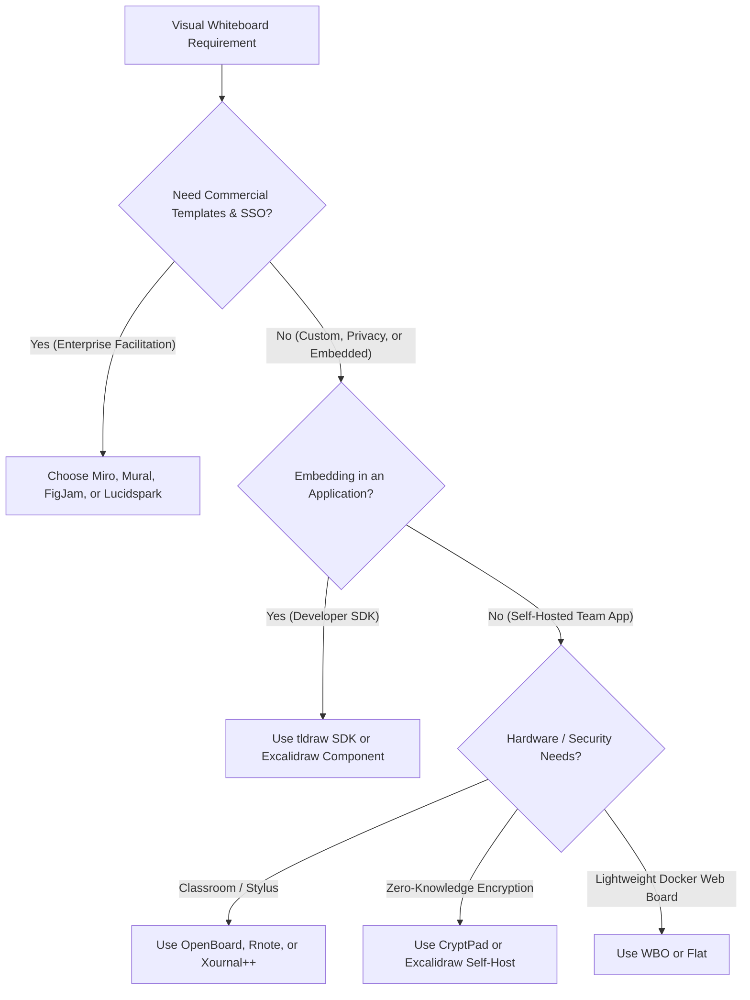

# 🎨 Awesome Virtual Whiteboard

  

  
  
  
  
  
  

---

> **A comprehensive, SEO-curated index of top SaaS platforms and open-source GitHub projects for virtual whiteboards, infinite collaborative canvases, online diagramming, and real-time visual teamwork.**

Whether you are facilitating agile sprint retrospectives, designing system architecture wireframes, brainstorming with distributed engineering teams, or embedding an infinite canvas directly into your web applications, this directory provides up-to-date benchmarks on pricing, free limits, company scale, and open-source star metrics.

---

## 📑 Table of Contents

- [📊 Sector Overview & Market Dynamics](#-sector-overview--market-dynamics)
- [💼 SaaS & Hosted Whiteboard Platforms](#-saas--hosted-whiteboard-platforms)
- [🔓 Open-Source Whiteboard & Canvas Projects](#-open-source-whiteboard--canvas-projects)
- [🧭 Decision & Architecture Guide](#-decision--architecture-guide)
- [🤝 How to Contribute](#-how-to-contribute)
- [📈 Star History](#-star-history)
- [💖 Support & Community](#-support--community)
- [📜 Disclaimer & License](#-disclaimer--license)

---

## 📊 Sector Overview & Market Dynamics

The global virtual whiteboard and digital visual collaboration market was valued at approximately **$3.1 billion in 2024** and is projected to surpass **$8.6 billion by 2030**, advancing at a robust Compound Annual Growth Rate (CAGR) of **~18.5%**, accelerated by enterprise adoption of hybrid work, asynchronous ideation, and visual documentation.

The market structure is **moderately concentrated yet bifurcated**:
- **At the Enterprise SaaS Layer**: The sector behaves as an oligopoly led by dedicated incumbents such as **Miro** ($17.5B valuation) and **Mural** ($2.0B valuation), alongside entrenched mega-cap technology ecosystems like **Microsoft Whiteboard**, **Apple Freeform**, **Canva**, and Figma's **FigJam**. These platforms leverage heavy network effects, deep enterprise security suites, and turnkey marketplace integrations.
- **At the Developer & Open-Source Layer**: The sector remains **highly fragmented and vibrant**. The emergence of open standards, Conflict-free Replicated Data Types (CRDTs), and headless canvas engines (led by **Excalidraw** and **tldraw**) empowers developers to self-host secure, privacy-first whiteboard stacks or natively embed bespoke infinite-canvas capabilities without recurring per-seat SaaS costs.

---

## 💼 SaaS & Hosted Whiteboard Platforms

Below is an overview of leading commercial and hosted virtual whiteboard SaaS suites, sorted in **descending order by company size** (market capitalization or latest reported private valuation).

| 🏢 Platform | 💰 Company Size (Valuation / Cap) | 🏷️ Starting Paid Tier | 🎁 Free Tier Limits | 🎯 Key Focus & Superpower |
| :--- | :--- | :--- | :--- | :--- |
| **[Apple Freeform](https://www.apple.com/ios/freeform/)** | ~$3.50 Trillion (Market Cap) | **$0.99/mo** (iCloud+ 50GB storage tier) | **Free forever** with any Apple ID; includes 5 GB shared iCloud sync storage and unlimited canvases across iOS, iPadOS, and macOS | Infinite canvas drawing optimized for Apple Pencil, low latency, and FaceTime SharePlay collaboration |
| **[Microsoft Whiteboard](https://www.microsoft.com/en-us/microsoft-whiteboard)** | ~$3.15 Trillion (Market Cap) | **$6.00/user/mo** (M365 Business Basic annual commitment) | **Free forever** with personal Microsoft Account (up to 10 participants per board, unlimited personal boards, standard ink tools) | Seamless deep integration with Microsoft Teams, Office 365, Copilot AI, and Surface Hub displays |
| **[Canva Whiteboards](https://www.canva.com/online-whiteboard/)** | ~$26.0 Billion (Valuation) | **$15.00/mo** (or $120.00/yr for Canva Pro) | **Free forever**; unlimited whiteboards, 5 GB cloud storage, 1M+ free design templates, stickers, and graphic assets | Marketing workflows, team workshops, rapid prototyping, and polished presentation design |
| **[Miro](https://miro.com/)** | ~$17.5 Billion (Valuation) | **$8.00/user/mo** (Starter plan billed annually; $10.00 billed monthly) | **Free forever**; 3 editable boards, unlimited team members, 2,500+ templates, core app integrations, and basic export | Industry-standard enterprise facilitation, agile sprint rituals, PI planning, and Jira/Confluence integration |
| **[FigJam](https://www.figma.com/figjam/)** | ~$12.5 Billion (Valuation) | **$3.00/editor/mo** (Billed annually; $5.00/editor billed monthly) | **Free forever**; up to 3 collaborative FigJam/Figma files, unlimited personal drafts, unlimited viewers, and full plugin library | Designer-developer workflows, interactive widgets, audio huddles, and 1-click Figma design sync |
| **[ClickUp Whiteboards](https://clickup.com/features/whiteboards)** | ~$4.0 Billion (Valuation) | **$7.00/user/mo** (Unlimited plan billed annually; $10.00 billed monthly) | **Free forever**; 3 active whiteboards, 100 MB cloud storage, unlimited team members, and full core task management | Direct bidirectional conversion between visual sticky notes and project sprint backlog tasks |
| **[Lucidspark](https://lucidspark.com/)** | ~$3.0 Billion (Valuation) | **$7.95/user/mo** (Individual plan billed annually; $9.00/user/mo for Team) | **Free forever**; 3 editable boards, 60 visual objects per board, and 300+ standard facilitation templates | Technical system architecture mapping, Lucidchart diagram sync, and structured enterprise ideation |
| **[Mural](https://www.mural.co/)** | ~$2.0 Billion (Valuation) | **$9.99/user/mo** (Team+ plan billed annually; $12.00 billed monthly) | **Free forever**; 3 active murals, unlimited invited collaborators, infinite canvas, and curated facilitation super-tools | Design thinking methodology, executive consulting workshops, and guided timed exercises |
| **[Klaxoon](https://klaxoon.com/)** | ~$250 Million (Valuation) | **€9.00 (~$9.80)/user/mo** (Billed annually; €14.00 billed monthly) | **Free forever**; 1 active Board, up to 10 participants, 500 visual ideas/post-its, and core interaction features | Interactive corporate training, gamified meetings, live polls, quizzes, and visual agile routines |
| **[Bluescape](https://www.bluescape.com/)** | ~$100 Million (Valuation) | **$10.00/user/mo** (Team plan billed annually) | **30-day free trial** with full enterprise collaboration suite, unlimited workspaces, and HD video huddles | High-security government, defense, and entertainment media multi-asset command centers |
| **[Conceptboard](https://conceptboard.com/)** | ~$35 Million (Valuation / ~$10M ARR) | **$6.00/user/mo** (Premium plan billed annually; $7.50 billed monthly) | **Free forever**; 1 active board, up to 100 objects limit, 500 MB file storage, and unlimited external viewers | Strict GDPR-compliant European hosting, PDF markup, and enterprise data privacy compliance |
| **[Stormboard](https://stormboard.com/)** | ~$20 Million (Valuation / ~$5M ARR) | **$8.33/user/mo** (Business plan billed annually; $10.00 billed monthly) | **Free forever**; 5 active Storm boards, up to 5 users per storm, and basic template library | Structured matrix reporting, agile backlog prioritization, and automated instant meeting summaries |
| **[Excalidraw+](https://plus.excalidraw.com/)** | ~$15 Million (Valuation) | **$6.00/user/mo** (Billed annually; $7.00/mo billed monthly) | **Free forever web app** at excalidraw.com (unlimited local/link canvases); **14-day free trial** for Excalidraw+ shared cloud workspaces | Cloud workspace management, team libraries, and automated presentation mode for Excalidraw |
| **[tldraw.com](https://www.tldraw.com/)** | ~$12 Million (Valuation) | **$6.00/user/mo** (Hosted cloud workspace tier) | **Free forever** at tldraw.com (unlimited free local canvases and multiplayer link-sharing sessions); open React SDK | Minimalist, blazing-fast infinite canvas with real-time vector sketching and modern developer SDK |

---

## 🔓 Open-Source Whiteboard & Canvas Projects

A curated collection of open-source virtual whiteboards, infinite canvas SDKs, and self-hosted drawing software. **Sorted in descending order by GitHub Stars_Count**.

| 📦 Repository & Project | 🌟 GitHub_Stars_Badge | ⚖️ License | 🚀 Architecture & Key Strengths |
| :--- | :--- | :--- | :--- |
| **[excalidraw/excalidraw](https://github.com/excalidraw/excalidraw)** |  | `MIT` | The premier virtual whiteboard for sketching hand-drawn style diagrams. Features end-to-end encryption, infinite canvas, custom shape libraries, export to SVG/PNG, and lightweight multiplayer rooms. |
| **[toeverything/AFFiNE](https://github.com/toeverything/AFFiNE)** |  | `Community / MIT` | Next-generation all-in-one visual workspace merging Notion-style markdown blocks with Miro-style infinite canvas whiteboards into a unified, privacy-first collaborative environment. |
| **[jgraph/drawio-desktop](https://github.com/jgraph/drawio-desktop)** |  | `GPL-3.0` | Official Electron desktop application build of draw.io (diagrams.net). Delivers a completely offline, secure, zero-cloud-telemetry diagramming and architectural whiteboarding studio. |
| **[tldraw/tldraw](https://github.com/tldraw/tldraw)** |  | `tldraw License` | Best-in-class infinite canvas toolkit and React SDK. Engineered for extreme performance, crisp vector math, multiplayer synchronization, extensible shapes, and AI-driven canvas experiments. |
| **[xournalpp/xournalpp](https://github.com/xournalpp/xournalpp)** |  | `GPL-2.0` | Cross-platform handwriting notetaking and whiteboard app supporting digital stylus pressure sensitivity, PDF annotation, audio synchronization, and LaTeX formula insertion. |
| **[plait-board/drawnix](https://github.com/plait-board/drawnix)** |  | `MIT` | All-in-one open-source whiteboard tool with integrated mind mapping, structured flowcharts, freehand drawing, and multi-user canvas collaboration. |
| **[flxzt/rnote](https://github.com/flxzt/rnote)** |  | `GPL-3.0` | Modern vector-based drawing and whiteboard sketching application written in Rust and GTK4. Built specifically for digital stylus tablets, teachers, and student note-taking. |
| **[jgraph/drawio](https://github.com/jgraph/drawio)** |  | `Apache-2.0` | Production client-side web technology powering diagrams.net. Exceptional for structured flowcharts, BPMN, cloud architecture schematics, and UML boards. |
| **[cryptpad/cryptpad](https://github.com/cryptpad/cryptpad)** |  | `AGPL-3.0` | Zero-knowledge, end-to-end encrypted collaboration suite featuring a dedicated whiteboard app. Protects sensitive corporate IP, strategy drawings, and private research. |
| **[zsviczian/obsidian-excalidraw-plugin](https://github.com/zsviczian/obsidian-excalidraw-plugin)** |  | `AGPL-3.0` | Embeds full Excalidraw whiteboards natively inside Obsidian knowledge vaults. Features bidirectional linking between canvas elements and Markdown notes, plus OCR text extraction. |
| **[mbrlabs/Lorien](https://github.com/mbrlabs/Lorien)** |  | `MIT` | Lightweight infinite-canvas drawing and whiteboarding application created with the Godot Game Engine. Features instantaneous startup, tiny file sizes, and responsive stylus ink. |
| **[netless-io/flat](https://github.com/netless-io/flat)** |  | `MIT` | Agora Flat open-source online classroom and interactive whiteboard client. Features multi-participant audio/video rooms, screen sharing, PPT rendering, and cloud recordings. |
| **[OpenBoard-org/OpenBoard](https://github.com/OpenBoard-org/OpenBoard)** |  | `GPL-3.0` | Open-source interactive teaching whiteboard software designed for schools, universities, interactive smart boards, and dual-monitor classroom lectures. |
| **[mypaint/mypaint](https://github.com/mypaint/mypaint)** |  | `GPL-2.0` | Fast, distraction-free graphic art and concept sketching application offering an infinite digital canvas and a highly customizable pressure-sensitive brush engine. |
| **[lovasoa/whitebophir](https://github.com/lovasoa/whitebophir)** |  | `AGPL-3.0` | **WBO**: Minimalist, real-time peer collaborative whiteboard powered by Node.js and HTML5 Canvas. Extremely easy to deploy locally via a single Docker command. |
| **[drawpile/Drawpile](https://github.com/drawpile/Drawpile)** |  | `GPL-3.0` | Collaborative networked drawing program where multiple illustrators sketch simultaneously on a shared canvas with granular layer permissions and session recording. |

---

## 🧭 Decision & Architecture Guide

When choosing between SaaS platforms and open-source virtual whiteboards, consider your team's specific requirements across these three core dimensions:

### 1. Hosted SaaS vs. Self-Hosted Open-Source
- **Hosted SaaS** (Miro, Mural, FigJam): Delivers out-of-the-box SOC2 compliance, Enterprise SSO (SAML/Okta), thousands of community templates, and zero operational overhead. Best for non-technical departments, business consultants, and design teams.
- **Self-Hosted Open-Source** (Excalidraw, WBO, CryptPad): Ensures complete sovereignty over visual intellectual property, zero per-seat licensing fees, and compliance with strict data-residency mandates (GDPR, HIPAA).

### 2. Synchronization Primitives: Operational Transformation vs. CRDTs
- Real-time multiplayer drawing demands sub-50ms latency. Modern solutions leverage **Conflict-free Replicated Data Types (CRDTs)** via libraries like Yjs or Automerge (used in tldraw and AFFiNE) to support conflict-free offline-first editing and peer-to-peer WebRTC or WebSocket sync.

---

## 🤝 How to Contribute

Contributions are warmly welcomed! Help keep this curated list up-to-date with emerging tools and libraries.

1. **Fork the repository** on GitHub.
2. **Create a branch**: `git checkout -b feature/add-new-whiteboard`
3. **Add your tool**:
   - For **SaaS**: Ensure you provide exact starting tier pricing, specific free limits, company size/valuation, and follow the descending size order.
   - For **Open-Source**: Provide the GitHub Stars_Badge (`style=social&color=white`) linking to the repository's `/stargazers` page, specify the SPDX license, and position in the star-sorted ranking.
4. **Verify formatting**: Ensure markdown tables and link anchors render properly.
5. **Open a Pull Request** with a concise description of why the tool deserves inclusion.

---

## 📈 Star History

---

## 💖 Support & Community

Thank you for exploring and bookmarking **Awesome-Virtual-Whiteboard**! 🌟

If you found this curated ecosystem directory valuable, please consider supporting its ongoing maintenance:
- ⭐ **Star this repository** to improve visibility across the open-source community.
- 🍴 **Fork and share** with your fellow developers, visual thinkers, and agile teams.
- 💬 **Join our community** on [Discord](https://discord.gg/jc4xtF58Ve) to discuss visual tools and architecture.
- ☕ **Sponsor the Maintainer**: Support ongoing curation and updates via the [GitHub Sponsor Dashboard](https://github.com/sponsors/ishandutta2007).

---

## 📜 Disclaimer & License

- **Disclaimer**: This repository is a community-curated directory. Brand names, logos, and trademarks belong to their respective corporate owners. Descriptions reflect public information as of October 2026.
- **License**: Released under the [MIT License](file:///C:/Users/hp/Documents/Projects/Awesome-Virtual-Whiteboard/LICENSE).
